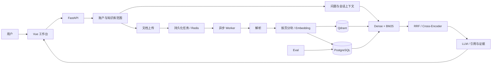

<div align="left">

# 企智搜｜KnowledgePilot

**企智搜｜KnowledgePilot** 面向企业知识管理与个人知识沉淀场景，基于 RAG 技术，将文档管理、多模态解析、混合检索、引用问答与质量评测整合到统一工作台。

从产品手册、业务制度到研究资料，企智搜将原始文档转化为可检索的知识单元，结合大语言模型生成带有原文依据的回答。用户可以沿着引用回到文档与页码，通过检索轨迹了解证据如何被找到，并将历史答案纳入持续评测。

> **知识管理 → 证据检索 → 引用问答 → 质量评测**，形成可追溯、可迭代的知识应用闭环。

### 适用场景

| 场景 | 使用方式 |
| --- | --- |
| 企业制度与业务知识 | 汇集制度、流程与操作规范，按问题定位条款及来源 |
| 产品与技术支持 | 将产品说明、使用手册和技术文档组织为可查询的知识库 |
| 研究与资料整理 | 跨文档检索关键信息，保留文献片段和页码依据 |
| RAG 应用开发 | 对比检索策略、检查 Agent 轨迹、复评历史答案与模型效果 |

## 核心能力

### 📚 统一知识空间

支持个人知识空间与团队知识库，提供管理员、编辑、只读角色，以及组织全员或指定成员可见范围。在同一界面完成文档上传、任务跟踪、内容预览与原文管理。支持单文件 **50 MiB** 上传、SHA256 去重、失败重试与重新索引。

摄取任务异步完成文档解析、文本分块、Embedding 与向量索引，任务状态持久化，支持租约恢复与退避重试。文档更新生成新版本，旧版持续服务，新索引就绪后切换；支持历史版本恢复、有效期和目录增量同步。

批量上传逐项展示提交结果，单个文件失败后继续处理其余文件；任务额度暂满时有限重试，支持暂停、继续及仅重试失败项。

### 🔎 多路召回与融合排序

结合 **Qdrant Dense Retrieval** 与持久化中文 **BM25 倒排索引**，兼顾语义表达和关键词命中，通过 **RRF** 融合候选排名，并支持使用 **Cross-Encoder** 进一步精排。

检索范围在查询前根据组织成员、知识库授权与活动版本确定，仅回查命中的候选正文。问答、向量召回、词项检索和历史来源遵循一致的数据访问范围。

### 💬 带有依据的知识问答

回答关联文档名称、页码和原文片段，支持来源编号与证据查看。多轮对话结合服务端会话历史检索，保留问题、答案和引用记录，便于回查与复评。支持真实模型流式输出、停止生成、请求幂等和会话并发保护。

生成后检查引用编号与数字，可选 LLM 核验事实支持和问题可回答性；证据不足时拒答，不支持的生成内容回退为明确标注的原文摘录。

### 🤖 Agent 检索模式

围绕“检索—证据检查—查询改写—生成”组织问答流程。在证据覆盖不足时进行有界关键词改写，对多轮候选合并去重，再统一精排。检索步骤与处理轨迹可在工作台查看。

### 🏠 灵活的私有化部署

支持 **Ollama、vLLM / OpenAI 兼容接口与 SentenceTransformers**，可根据硬件和数据需求选择模型。提供 Docker Compose 与本地开发两种运行方式，覆盖前端、API、独立摄取与评测 Worker、迁移及存储服务。

## 系统架构



| 层次 | 技术与职责 |
| --- | --- |
| 交互层 | Vue 3 · TypeScript · Vite，知识管理、问答与评测工作台 |
| 应用层 | FastAPI · SQLAlchemy · LangChain，接口、会话与模型适配 |
| 检索层 | Qdrant · BM25 · RRF · Cross-Encoder，向量召回与融合排序 |
| 任务与缓存 | Redis · SQL 持久化任务，异步摄取、租约恢复与结果复用 |
| 业务存储 | PostgreSQL，账户、知识库、文档、会话及评测记录 |
| 文档理解 | PyPDF · python-docx · Tesseract |

本地开发也可使用 SQLite 与 Qdrant local。

### 本地开发部署

环境要求：**Python 3.12、Node.js 20.19+**，以及可用的模型服务。

```bash
git clone https://github.com/fredtrump86/KnowledgePilot.git
cd KnowledgePilot

python -m venv .venv
source .venv/bin/activate
python -m pip install -e "./backend[dev,ml,evaluation]"

cd frontend
npm ci
cd ..
cp .env.ollama.example .env
```

Windows 可使用 `.venv\Scripts\Activate.ps1` 激活环境，也可使用已有 conda 环境。准备好 Docker 基础服务和模型后，在项目根目录一键启动：

```powershell
.\scripts\dev.ps1
# 使用其他 Conda 环境：.\scripts\dev.ps1 -CondaEnv your-env
# 仅检查现有服务：.\scripts\dev.ps1 -Service status
# 终端已关闭时停止三个服务：.\scripts\dev.ps1 -Service stop
```

脚本默认使用 `cook-rag-1`，在同一个终端启动 API、前端与所需的独立 Worker，按服务名称汇总日志。按 **Ctrl+C** 停止本次启动的进程；已运行的健康服务会被复用并保留。未启用 Redis 时使用 API 内置任务线程。启动器不会自动切换端口，发现其他程序占用端口时会给出明确提示。

其他系统或已激活 Python 环境时，可直接运行 `python scripts/dev.py`。访问 [http://localhost:5173](http://localhost:5173)。启用 Redis 队列时须同时配置 Qdrant server；本次新启动服务的日志保存在 `artifacts/dev/`。

## 开始使用

1. **建立知识空间**：注册账户，按业务或主题创建知识库。
2. **导入文档**：上传手册、制度或研究资料，等待解析与索引完成。
3. **提问并查看证据**：选择知识库与问答模式，结合原文引用核对答案。
4. **持续评测**：将答案加入评测集，填写参考答案与期望文档，对比检索策略与模型结果。

仓库提供 [演示文档](examples/company-handbook.md)、[产品说明](examples/product-guide.md) 和 [评测案例](examples/evaluation-cases.json)，可用于体验完整流程。

## 项目结构

```text
KnowledgePilot/
├── backend/
│   ├── app/
│   │   ├── api/             # 账户、知识库、文档、问答与评测接口
│   │   ├── services/        # 文档理解、检索、生成与评测
│   │   ├── models.py        # 业务数据模型
│   │   └── worker.py        # 异步摄取与任务恢复
│   └── tests/               # 接口与检索链路测试
├── frontend/                # Vue 3 知识工作台
├── docs/                    # 架构、部署与评测文档
├── examples/                # 示例文档与评测案例
├── scripts/                 # 开发与验证工具
└── docker-compose.yml       # 应用与基础服务编排
```
